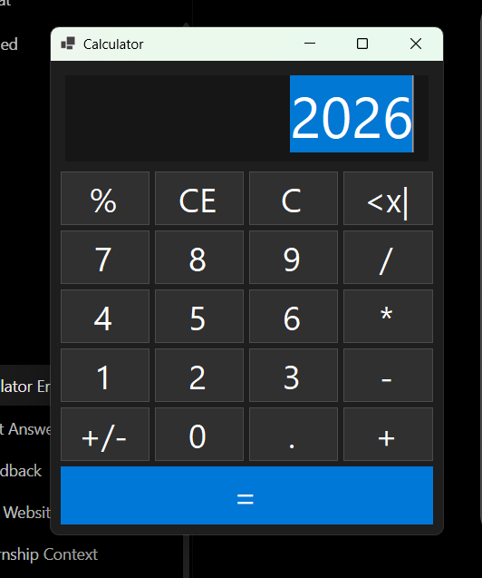
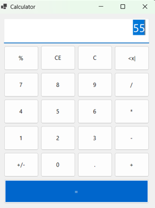
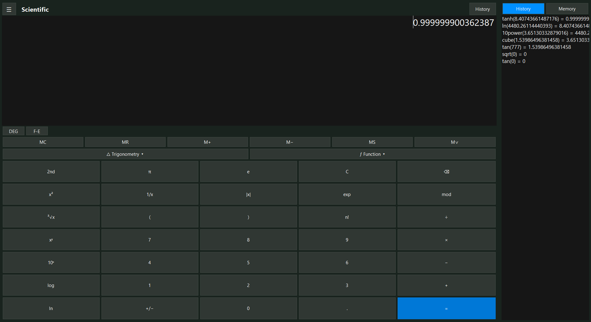
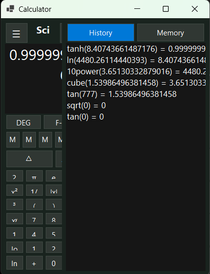
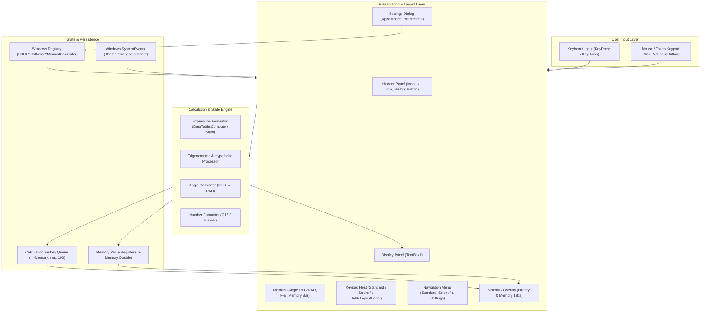

# Calculator

> "A modern, responsive desktop calculator engineered in Visual Basic .NET and Windows Forms on .NET 10."

An elegant, high-performance Windows desktop calculator featuring standard everyday arithmetic, an extensive scientific engineering engine, real-time calculation history, persistent theme customization (Dark, Light, and System), dedicated memory registers, and an adaptive responsive interface. Distributed as a self-contained, single-file 64-bit Windows executable packaged with an Inno Setup installer.

[](https://learn.microsoft.com/en-us/dotnet/visual-basic/)
[](https://dotnet.microsoft.com/)
[](https://learn.microsoft.com/en-us/dotnet/desktop/winforms/)
[](https://www.microsoft.com/windows)
[](https://github.com/debasmithrout/calculator)
[](https://learn.microsoft.com/en-us/dotnet/core/deploying/single-file)
[](https://jrsoftware.org/isinfo.php)

---

## Table of Contents

1. [Project Overview](#1-project-overview)
2. [Application Screenshots](#2-application-screenshots)
3. [Features and Capabilities](#3-features-and-capabilities)
4. [Standard Calculator Mode](#4-standard-calculator-mode)
5. [Scientific Calculator Mode](#5-scientific-calculator-mode)
6. [Calculation History](#6-calculation-history)
7. [Memory Functions](#7-memory-functions)
8. [Themes and Appearance Settings](#8-themes-and-appearance-settings)
9. [Navigation and Responsive UI](#9-navigation-and-responsive-ui)
10. [Keyboard Support](#10-keyboard-support)
11. [Technology Stack](#11-technology-stack)
12. [Application Architecture](#12-application-architecture)
13. [Project Structure](#13-project-structure)
14. [Installation Guide](#14-installation-guide)
15. [Running the Application](#15-running-the-application)
16. [Publishing and Deployment](#16-publishing-and-deployment)
17. [System Requirements](#17-system-requirements)
18. [Data Storage and Privacy](#18-data-storage-and-privacy)
19. [Troubleshooting](#19-troubleshooting)
20. [Future Improvements](#20-future-improvements)
21. [Author](#21-author)
22. [License](#22-license)

---

## 1. Project Overview

**Calculator** is a native Windows desktop application developed in **Visual Basic .NET (VB.NET)** targeting the **.NET 10.0-windows** platform. It provides a fluid, modern calculation utility crafted with Windows Forms, adhering to contemporary desktop design aesthetics inspired by Windows 11 Fluent UI.

The application seamlessly bridges fast everyday arithmetic with advanced mathematical computing:

- **Dual Operating Modes:** Easily toggle between **Standard Mode** for fast routine operations and **Scientific Mode** for advanced trigonometry, powers, roots, logarithms, factorials, and angle unit conversions.
- **Responsive Layout Engine:** Employs dynamic table layout panels and overlay hosts that adjust gracefully across window sizes, supporting both compact desktop views and expansive maximized workspaces.
- **Dynamic Theme Management:** Native Dark and Light palettes with live synchronization to Windows OS theme changes, backed by persistent Windows Registry storage.
- **Audit History & Memory Storage:** Maintains a continuous audit log of calculations with one-click result recall, alongside dedicated floating-point memory registers.
- **Zero-Dependency Deployment:** Published as a self-contained, single-file win-x64 binary bundled with an Inno Setup installer, requiring no pre-installed .NET runtimes on target machines.

---

## 2. Application Screenshots

<div align="center">

### Standard Calculator &mdash; Dark Theme

<p><em>Figure 1: Standard Calculator interface running in Dark Mode with high-contrast input typography and accent evaluation button.</em></p>

<br/>

### Standard Calculator &mdash; Light Theme

<p><em>Figure 2: Standard Calculator interface running in Light Mode with clean surface styling.</em></p>

<br/>

### Scientific Calculator &mdash; Comprehensive Workspace

<p><em>Figure 3: Full Scientific Mode showcasing the five-column keypad, angle/notation toolbar, trigonometry and function menus, and integrated calculation history panel.</em></p>

<br/>

### Calculation History &mdash; Record Panel

<p><em>Figure 4: Calculation History flyout displaying step-by-step mathematical expressions and results ready for instant reload.</em></p>

</div>

---

## 3. Features and Capabilities

| Category | Capability | Description |
| :--- | :--- | :--- |
| **Arithmetic** | Basic & Chain Operations | Addition (`+`), subtraction (`−`), multiplication (`×`), division (`÷`), and modulo (`mod`). |
| **Numeric Utilities** | Clear, Backspace & Sign | Clear Entry (`CE`), Clear All (`C`), Backspace (`⌫`), and sign negation (`+/−`). |
| **Percentages** | Fractional Scaling | One-click percentage transformation (`%`) dividing active operand by 100. |
| **Trigonometry** | Circular & Hyperbolic | Standard (`sin`, `cos`, `tan`), hyperbolic (`sinh`, `cosh`, `tanh`), and inverse functions (`asin`, `acos`, `atan`, `asinh`, `acosh`, `atanh`). |
| **Angle Modes** | DEG / RAD Selection | Active angle unit toggle affecting circular trigonometric computations. |
| **Powers & Roots** | Exponents & Radicals | Square (`x²`), cube (`x³`), power (`xʸ`), 10 to power (`10ˣ`), 2 to power (`2ˣ`), square root (`√x`), and cube root (`³√x`). |
| **Logarithms** | Common & Natural | Common logarithm (`log` / base 10), natural logarithm (`ln` / base $e$), and natural exponential (`exp`). |
| **Combinatorics** | Factorial | Factorial calculation (`n!`) supported for non-negative integers up to $170!$. |
| **Notation** | F-E Scientific Display | Toggle between general notation (`G15`) and scientific exponential notation (`E6`). |
| **Memory System** | 6 Register Operations | Memory Clear (`MC`), Recall (`MR`), Add (`M+`), Subtract (`M−`), Store (`MS`), and context menu (`Mv`). |
| **Audit History** | Calculation Log | Real-time storage of up to 100 historical expressions with double-click reload. |
| **Appearance** | Theme Engine | Light, Dark, and System theme preferences backed by Windows Registry persistence. |
| **UI Experience** | No-Focus Buttons | Custom button subclass eliminating distracting Windows focus dotted rectangles. |
| **Keyboard Input** | Full Hotkey Binding | Complete numeric keypad, operator hotkeys, Enter, Escape, Backspace, and Delete support. |

---

## 4. Standard Calculator Mode

Standard Mode delivers an efficient, distraction-free environment for day-to-day arithmetic.

- **Layout Structure:** Organized in a 4-column by 6-row grid with an expansive, prominent `=` action button spanning the bottom row.
- **Arithmetic Evaluation:** Uses the .NET data engine to parse expressions with proper mathematical precedence and decimal precision.
- **Immediate Controls:**
  - `CE` (Clear Entry): Resets the current number input without erasing pending operations.
  - `C` (Clear All): Fully clears pending operands, operators, and resets the display to `0`.
  - `⌫` (Backspace): Deletes the trailing digit from the active display.
  - `+/−` (Sign Toggle): Inverts the positive/negative sign of the displayed value.
  - `%` (Percentage): Instantly calculates `value / 100`.
- **Decimal Management:** Validates decimal points to prevent duplicate periods within a single number string.

---

## 5. Scientific Calculator Mode

Scientific Mode expands the interface into a comprehensive engineering workstation with a dedicated 5-column keypad, toolbar options, and specialized dropdown menus.

### 5.1 Angle Modes & Notation Toolbar
- **`DEG` / `RAD` Toggle:** Switches angle calculations between Degrees and Radians. When `DEG` is active, input angles are automatically converted to radians prior to evaluation, and inverse trigonometric outputs are converted back to degrees.
- **`F-E` (Format Exponential):** Switches output representation between standard general formatting (`G15` up to 15 significant digits) and scientific exponential notation (`E6`, e.g., `1.234567E+03`). An active indicator (`F-E ✓`) denotes enabled exponential mode.

### 5.2 Scientific Keypad Operations
- **Secondary Function (`2nd`):** Toggles secondary operations across key surfaces and menus:
  - `x²` toggles to `x³` (Cube).
  - `10ˣ` toggles to `2ˣ` (Power of 2).
  - Trigonometry menu items toggle to their respective inverse functions.
- **Constants:** Instant injection of fundamental mathematical constants:
  - $\pi$ (`Math.PI` $\approx 3.141592653589793$)
  - $e$ (`Math.E` $\approx 2.718281828459045$)
- **Powers & Roots:**
  - Square (`x²`) and Cube (`x³`)
  - Arbitrary Power (`xʸ`): Handles two-stage exponentiation
  - Square Root (`²√x`): Guarded against negative inputs
  - Cube Root (`³√x`): Preserves negative signs via `Math.Sign(value) * |value|^(1/3)`
- **Logarithmic Functions:**
  - Common Logarithm (`log`): Base 10 logarithm with non-positive input guard
  - Natural Logarithm (`ln`): Base $e$ logarithm with non-positive input guard
  - Natural Exponential (`exp`): Computes $e^x$
- **Discrete & Algebraic Math:**
  - Factorial (`n!`): Iterative factorial calculation validated for integers $0 \le n \le 170$
  - Reciprocal (`1/x`): Multiplicative inverse with division-by-zero protection
  - Absolute Value (`|x|`): Computes magnitude
  - Modulo (`mod`): Two-stage remainder calculation

### 5.3 Specialized Menus
- **$\Delta$ Trigonometry Menu:**
  - Standard mode: `sin`, `cos`, `tan`, `sinh`, `cosh`, `tanh`
  - Secondary (`2nd`) mode: `asin`, `acos`, `atan`, `asinh`, `acosh`, `atanh`
  - Strict mathematical domain checks (e.g., undefined tangent at $90^\circ$ and domain restrictions on arc functions).
- **$f$ Function Menu:**
  - Direct menu access to `Square root`, `Cube root`, `Square`, `Cube`, `Reciprocal`, `Absolute value`, `Factorial`, `10 to the power of x`, `e to the power of x`, `Common logarithm`, and `Natural logarithm`.

---

## 6. Calculation History

The application incorporates a continuous audit trail to review past mathematical operations without losing context.

- **Storage Capacity:** In-memory queue storing up to **100 recent calculations**. When capacity is reached, older entries are gracefully retired.
- **Format:** Records the exact expression alongside the computed result:
  ```text
  tanh(8.40743661487176) = 0.999999900362387
  ln(4480.26114440393) = 8.40743661487176
  10power(3.65130332879016) = 4480.26114440393
  cube(1.53986496381458) = 3.65130332879016
  tan(777) = 1.53986496381458
  sqrt(0) = 0
  ```
- **Instant Reload:** Double-clicking any entry in the history list automatically extracts the result and places it directly into the calculator display for subsequent operations.
- **Empty State Presentation:** Displays a clean `"There's no history yet."` placeholder when the log is empty.

---

## 7. Memory Functions

The memory bar delivers six standard memory operations for managing stored intermediate results:

| Button | Name | Functionality |
| :---: | :--- | :--- |
| **`MC`** | Memory Clear | Resets the stored memory register to `0`. |
| **`MR`** | Memory Recall | Recalls the stored memory value directly onto the main display. |
| **`M+`** | Memory Add | Adds the current display number to the existing value in memory. |
| **`M−`** | Memory Subtract | Subtracts the current display number from the existing value in memory. |
| **`MS`** | Memory Store | Overwrites the memory register with the number currently displayed. |
| **`Mv`** | Memory Menu | Opens a context dropdown displaying the current value (`Memory: <val>`), with quick options to Recall or Clear. |

The Memory register is also mirrored within the right-hand sidebar tab (`Memory`), displaying `M = <value>`.

---

## 8. Themes and Appearance Settings

Calculator features a robust theming architecture designed for visual comfort and high readability.

### 8.1 Supported Modes
- **Dark Mode:** Deep charcoal surfaces (`#1E1E1E`), dark control tiles, crisp white numerals, and Windows accent blue (`#0078D7`).
- **Light Mode:** Soft off-white backgrounds (`#F5F5F5`), clean light gray keys, dark typography, and vibrant blue action highlights.
- **System Mode:** Actively monitors Windows theme personalization (`SystemUsesLightTheme`) and synchronizes appearance automatically in real time via `SystemEvents.UserPreferenceChanged`.

### 8.2 Settings Dialog
Accessible via the hamburger menu, the **Settings** dialog provides:
- Clean card-style UI with radio button controls for **Light**, **Dark**, and **Use system setting**.
- Immediate theme preview application upon selecting any option.

### 8.3 Persistent Storage
Theme preferences are persisted across application restarts in the Windows Registry:
- **Registry Key:** `HKCU\Software\MinimalCalculator`
- **Value Name:** `ThemeMode` (`"Light"`, `"Dark"`, or `"System"`)

---

## 9. Navigation and Responsive UI

### 9.1 Hamburger Navigation Drawer
Clicking the `≡` menu button invokes a flyout navigation drawer offering immediate access to:
- **Standard:** Switches to the compact 4-column arithmetic layout.
- **Scientific:** Switches to the full 5-column engineering keypad with scientific toolbar.
- **Settings:** Opens the modal appearance configuration dialog.

### 9.2 Responsive History & Memory Panel
The application dynamically reorganizes its components depending on window width and state:
- **Maximized & Wide Windows:** The History/Memory sidebar is embedded as a dedicated **300-pixel right-hand column** alongside the keypad, providing side-by-side visibility.
- **Compact Windows:** Toggling the History button smoothly presents an adaptive **slide-up modal overlay** (occupying 62% of client height) directly over the keypad.

### 9.3 NoFocusButton Architecture
All keypad and toolbar controls are built upon a custom `NoFocusButton` subclass that inherits from `System.Windows.Forms.Button`:
- `TabStop = False`: Removes buttons from tab order to prioritize keyboard calculation input.
- `ShowFocusCues = False`: Suppresses default Windows dotted focus rectangles on click, ensuring a modern, distraction-free visual appearance.

---

## 10. Keyboard Support

Calculator includes comprehensive keyboard event interception via `KeyPreview`, allowing full operation without a mouse:

| Key / Shortcut | Action | Description |
| :--- | :--- | :--- |
| `0` &ndash; `9` | Digit Entry | Appends the corresponding numeric digit to display. |
| `.` or `,` | Decimal Point | Appends decimal separator (prevents duplicate entry). |
| `+` | Add | Initiates addition operation. |
| `-` | Subtract | Initiates subtraction operation. |
| `*` | Multiply | Initiates multiplication operation. |
| `/` | Divide | Initiates division operation. |
| `%` | Percentage | Converts current display value to percentage (`value / 100`). |
| `Enter` | Equals (`=`) | Evaluates the active calculation expression. |
| `Backspace` | Backspace (`⌫`) | Removes the most recently entered digit. |
| `Escape` | Clear All (`C`) | Resets active entry, pending operations, and display. |
| `Delete` | Clear Entry (`CE`) | Clears the current input value without erasing pending operators. |
| Arrow Keys | Dialog Interception | Arrow navigation suppressed via `ProcessDialogKey` to preserve keypad focus. |

---

## 11. Technology Stack

- **Programming Language:** Visual Basic .NET (`VB.NET 17.0+`)
- **Target Framework:** `.NET 10.0-windows` (`net10.0-windows`)
- **UI Platform:** Windows Forms (`System.Windows.Forms`)
- **Target Architecture:** Windows 64-bit (`win-x64`)
- **Development Environment:** Microsoft Visual Studio
- **Build System:** .NET SDK 10 / MSBuild
- **Installer Framework:** Inno Setup Compiler 7.1+
- **Data Persistence:** Windows Registry API (`Microsoft.Win32.Registry`)

---

## 12. Application Architecture

The following diagram illustrates the component architecture, data flow, and external system integrations of Calculator:



---

## 13. Project Structure

The committed repository source tree is organized as follows:

```text
calculator/
├── .gitattributes                  # Git line ending normalization
├── .gitignore                      # Visual Studio and .NET build ignore rules
├── ApplicationEvents.vb            # WinForms application event hooks
├── calculator.slnx                 # Visual Studio solution file
├── calculator.vbproj               # .NET 10 Windows Forms project configuration
├── calculator.vbproj.user          # Visual Studio user options
├── Class1.vb                       # Custom NoFocusButton control implementation
├── Form1.Designer.vb               # Form layout component declarations
├── Form1.resx                      # WinForms visual resource definitions
├── Form1.vb                        # Core calculation engine, UI layouts, and themes
├── My Project/
│   ├── Application.Designer.vb     # Application framework initialization
│   └── Application.myapp           # Application definition manifest
├── screenshots/
│   ├── calculation-history.png     # Genuine calculation history panel screenshot
│   ├── scientific-mode.png         # Genuine scientific mode screenshot
│   ├── standard-dark.png           # Genuine standard dark mode screenshot
│   └── standard-light.png          # Genuine standard light mode screenshot
└── README.md                       # Project documentation
```

> [!NOTE]
> Build output directories (such as `bin/` and `obj/`) are produced locally during compilation and are excluded from version control via `.gitignore`.

---

## 14. Installation Guide

Calculator is distributed with a lightweight Windows installer (`CalculatorSetup.exe`) generated with Inno Setup.

### 14.1 Step-by-Step Installation
1. Obtain `CalculatorSetup.exe` from your release distribution.
2. Double-click `CalculatorSetup.exe` to launch the Setup Wizard.
3. Review the installation information:
   - **Target Architecture:** Windows 64-bit (`x64`).
   - **Installation Scope:** Current Windows user (`lowest` privileges required; no administrator prompt needed).
   - **Installation Directory:** `{localappdata}\Programs\Calculator`.
4. Click **Next** to proceed with installation. The installer will unpack the self-contained executable.
5. Choose whether to launch Calculator immediately and click **Finish**.
6. Desktop and Start Menu shortcuts are automatically created for convenient access.

### 14.2 Uninstallation
To remove Calculator from your system:
- Open **Windows Settings** &gt; **Apps** &gt; **Installed apps**.
- Locate **Calculator** and click **Uninstall**.
- Alternatively, launch the uninstall shortcut from the Calculator Start Menu folder.

---

## 15. Running the Application

### 15.1 From Installed Shortcut
Launch Calculator anytime from your Windows Start Menu or Desktop shortcut.

### 15.2 From Visual Studio
1. Open `calculator.slnx` in Visual Studio.
2. Select **Debug** or **Release** configuration and **Any CPU** or **x64**.
3. Press **F5** or click the **Start** button to compile and run.

### 15.3 From Command Line (.NET CLI)
Ensure the .NET 10 SDK is installed:

```powershell
# Navigate to repository root
cd calculator

# Restore dependencies and build
dotnet build

# Launch the application
dotnet run
```

---

## 16. Publishing and Deployment

Calculator is configured to publish as a **self-contained, single-file executable**, ensuring that end-users do not need to install the .NET 10 runtime separately.

### 16.1 Publishing Self-Contained Binary
Run the following PowerShell command to generate the standalone single-file binary:

```powershell
dotnet publish calculator.vbproj `
    -c Release `
    -r win-x64 `
    --self-contained true `
    /p:PublishSingleFile=true `
    /p:IncludeNativeLibrariesForSelfExtract=true
```

Output directory:
```text
bin\Release\net10.0-windows\win-x64\publish\calculator.exe
```

### 16.2 Inno Setup Installer Compilation
The installer script (`Calculator.iss`) compiles the published executable into `CalculatorSetup.exe`:

```pascal
#define MyAppName "Calculator"
#define MyAppVersion "1.5"
#define MyAppPublisher "Debasmith"
#define MyAppExeName "calculator.exe"
#define PublishDir ".\publish"

[Setup]
AppId={{180D8020-60D5-42EB-962A-F43E46905BE0}
AppName={#MyAppName}
AppVersion={#MyAppVersion}
AppPublisher={#MyAppPublisher}
DefaultDirName={localappdata}\Programs\{#MyAppName}
ArchitecturesAllowed=x64
ArchitecturesInstallIn64BitMode=x64
PrivilegesRequired=lowest
Compression=lzma2
SolidCompression=yes
WizardStyle=modern
```

Compile with Inno Setup Compiler to produce `CalculatorSetup.exe` (~35 MB self-contained).

---

## 17. System Requirements

| Specification | Requirement | Details |
| :--- | :--- | :--- |
| **Operating System** | Windows 10 / Windows 11 | 64-bit editions supported (`x64`) |
| **Architecture** | 64-bit (`x64`) | Enforced by Inno Setup installer (`ArchitecturesAllowed=x64`) |
| **Runtime Dependency** | None | Published as a self-contained executable with .NET 10 embedded |

---

## 18. Data Storage and Privacy

Based on source code verification:

- **Runtime Volatile Data:**
  - **Calculation History:** Maintained entirely in application memory (`List(Of String)`). All history records are erased when the application process terminates.
  - **Memory Register:** Stored as an in-memory double-precision variable (`memoryValue`). Cleared upon exiting the application.
- **Persistent Configuration:**
  - **Theme Preference:** The only data persisted to disk is the user's selected theme mode, stored locally in the Windows Registry under:
    ```text
    HKEY_CURRENT_USER\Software\MinimalCalculator\ThemeMode
    ```
    Accepted values: `"Light"`, `"Dark"`, or `"System"`.
- **Privacy & Local Execution:**
  - Operates completely locally on the host machine.
  - The codebase contains no network requests, remote API calls, analytics, or background services.

---

## 19. Troubleshooting

### Display Shows "Error"
- **Cause:** An invalid mathematical operation was attempted, such as dividing by zero (`1 / 0`), evaluating negative roots (`√-1`), non-positive logarithms (`log(0)` or `ln(-5)`), out-of-range inverse trigonometry (`asin(2)`), or calculating factorials beyond `170!`.
- **Resolution:** Press `C` or `Escape` to clear the error state and resume calculation with valid numerical operands.

### Theme Does Not Match Windows Automatically
- **Cause:** A manual theme override (`Light` or `Dark`) was previously selected in Settings.
- **Resolution:** Open **Menu (≡)** &gt; **Settings**, select **Use system setting**, and the application will immediately resume synchronizing with your OS theme.

### Antivirus False Positive During Setup
- **Cause:** Some heuristic antivirus scanners may flag newly published single-file self-extracting .NET binaries.
- **Resolution:** The binary is built directly from open Visual Basic .NET source code without any malicious routines. Add an exclusion in your security suite for `calculator.exe` or whitelist `CalculatorSetup.exe`.

### Installer Informs Another Instance Is Running
- **Cause:** An existing instance of `calculator.exe` is currently open while running the installer.
- **Resolution:** Close any running Calculator windows from the taskbar, then click **Retry** in the Setup Wizard.

---

## 20. Future Improvements

Planned future enhancements under consideration:

- [ ] **Unit Converter:** Dedicated modules for Currency, Length, Weight, Volume, Temperature, and Speed.
- [ ] **Programmer Mode:** Hexadecimal, Decimal, Octal, and Binary conversions with bitwise logic operators (`AND`, `OR`, `XOR`, `NOT`, `NAND`, `NOR`, bit shifts).
- [ ] **Graphing Visualizer:** 2D function plotting for mathematical expressions.
- [ ] **History Export:** Ability to export calculation logs to CSV, JSON, or formatted plain text files.
- [ ] **Custom Accent Colors:** User-selectable accent color themes beyond Windows default blue.

---

## 21. Author

**Debasmith Rout**

- GitHub: [@debasmithrout](https://github.com/debasmithrout)
- Target Repository: [calculator](https://github.com/debasmithrout/calculator)

---

## 22. License

No license has been specified for this project yet. All rights are reserved by the author. Redistribution, modification, or commercial use requires explicit permission from the author.
